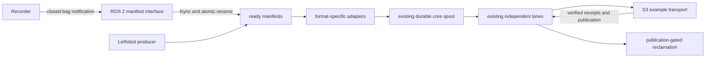

# Robotics SDK install and fleet reliability fixes

Date: 2026-10-13
Version: 1

## User Input Specs

Close the twelve reported install, discovery, capacity, lifecycle, integration,
CLI, packaging and operator-documentation issues. Implement and run tests in
https://github.com/v-modal/vmodal_sdk_robotics, then commit and push that public
repository. This monorepo file is the requested development plan; it is not the
test checkout. Public implementation lives in `lerobot/`.

## Scope

Public `lerobot/src/vmodal_robot`, `lerobot/tests`, `lerobot/examples`, package
metadata, shell entry points, READMEs, docs and public compatibility workflow.
Use the existing runner, spool, manifest contract and test fixtures. No new
environment, no merge commands, no scanning real data in `ztmp/`.

## Critical invariant

Producer originals remain authoritative and are never cleanup-owned. Immutable
ready manifests define handoff. SQLite records durable admission, stable IDs and
receipts. Remote ACK requires exact-byte checksum evidence; publication follows
every artifact ACK. Unknown outcomes retain local data. A capability declaration
alone does not qualify a deployed backend.

The public baseline already implements fair batched discovery, one absolute
shutdown deadline, and publication-gated reclamation. Verify those implementations
with existing fault tests instead of duplicating them.

## Data Contract

- Keep LeRobot v3 contract version 1 unchanged. Discovery batch size limits work
  per poll, never the total manifest population; deferred input rotates fairly.
- Raise default local video admission to 1 GiB, retaining explicit backend-limit
  validation, quotas, override and all-or-nothing revision admission.
- Reclaim only verified ACK payloads after all referencing revisions are durable;
  preserve database identities, receipts, pending bytes and producer originals.
- S3 example stores unchanged bytes and immutable descriptors under destination
  and stable ID, verifies remote SHA-256, conditionally creates objects, and
  publishes an immutable revision containing original descriptors. Distinguish
  absent, unavailable and conflict. No search/index/actuation claims.
- Closed ROS bag handoff uses its own `rosbag2` source contract, metadata.yaml and
  native bag files; do not label ROS data as LeRobot. Recorder completion must be
  explicit; file existence or a quiet interval is not proof of closure.

## Component Diagram Flows



### Coupling and dependencies between components

Adapters return existing RevisionInput/ArtifactInput values. Runner consumes the
existing Transport protocol. ROS imports remain optional and isolated from core;
S3 dependencies are an optional extra. Package all runtime helpers under
`vmodal_robot`; retain source compatibility helpers without publishing `src`.

## Folder Tree files Structure

```text
lerobot/src/vmodal_robot/
  adapters/rosbag.py       # closed-bag contract reader
  ros2_manifest.py        # completion notification to durable handoff
  transports/s3.py        # worked immutable S3 transport
  _support/               # qualified runtime logging/base helpers
lerobot/tests/            # existing simple Fire assertion tests plus regressions
lerobot/docs/             # integration examples, contracts and verification
.github/workflows/        # stock-pip install, ROS bag handoff, MinIO checks
```

## List of potential failures issues

- Admission: accepted files mask later manifests; deferred work starves; raised
  per-video limits exceed spool/backend capacity. Existing regressions cover
  rotation, retries and atomic rejection; extend default/large-file checks.
- Lifecycle: request timeout or close exceeds drain budget; ambiguous remote
  outcome loses bytes. Re-run actual subprocess SIGTERM tests across phases.
- Cleanup: ACK alone deletes shared unpublished payloads; legacy unverified
  receipts appear verified. Re-run sharing, retention and migration tests.
- S3: lost response, conditional-write race, checksum/identity conflict,
  unavailable lookup, incomplete revision. Fault tests plus actual MinIO checks.
- ROS: notification before close, mutated files, restart duplicates, callback
  hashing blocks execution. Explicit closed-recorder contract, worker thread,
  immutable publication, native bag integration in Humble/Jazzy CI.
- Packaging: distro pip cannot parse metadata, generic namespace collision,
  examples expose imports, warnings hide missing files. Build and install wheel
  outside checkout; test README command before any build-tool bootstrap.

## List of files to be changed

- `pyproject.toml`, `MANIFEST.in`, shell scripts: compatible metadata, qualified
  namespaces, python3 and explicit entry points.
- `src/vmodal_robot/cli.py`, `spool.py`, `contracts.py`: consistent 1 GiB local
  default, capability validation and accurate help.
- New ROS adapter/node and S3 transport: isolated optional interfaces.
- Existing and new tests: public-checkout fault, package and integration checks.
- Both READMEs, `docs/transport_contract.md`, integration docs and public workflow:
  real install commands, spool provisioning, producer handoff and backend limits.

## Implementation Blocks and Steps

### P0 — Existing data/lifecycle fixes (issues 1, 3, 4)

Inspect current public code and run existing discovery, runner, spool and CLI
fault tests. Preserve fair batches, deferred retries, deadline cancellation,
uncertain claims and publication-gated cleanup. Fix any reproduced regression.
Test 250+ manifests, SIGTERM during each phase, shared revisions and retained ACKs.

### P1 — Admission limits and spool operators (issues 2, 12)

Raise local default to 1 GiB consistently and update default-sensitive tests.
Keep qualified transport limits separate. Document independent video/telemetry
manifests, backend caps and persistent writable spool provisioning; explain the
current relative default and `/var/lib` deployment override. Test above-100-MiB
admission and exact configured boundary rejection.

### P2 — Object-storage example (issue 5)

Implement the Transport seam with asynchronous S3 operations, conditional create,
streamed remote hash verification, descriptors and immutable revision publication.
Document all ten capabilities, setup, retrieval and limitations. Add fake fault
tests and actual MinIO integration; claim only evidence produced by these tests.

### P3 — Closed-bag automation (issue 6)

Add a ROS 2 node consuming explicit completed-bag paths and a separate bag adapter.
Hash/fsync off the callback, atomically publish immutable manifests, preserve bag
metadata/storage bytes, and report errors. Add retry/restart behavior and both
plain assertion tests and real ros2-record/notification checks in public CI.

### P4 — Install, CLI and packaging (issues 7–11)

Use authoritative `setup.cfg` metadata compatible with stock Ubuntu 22.04 pip
while retaining isolated builds. Fresh-container testing reproduced Ubuntu's
isolated-backend path problem as well as the reported PEP 639 incompatibility;
capping setuptools alone still produced an empty UNKNOWN wheel. Keep static name
and dynamic version in setup.cfg; CI must check the installed name and CLI too.
Relocate published support helpers into `vmodal_robot` and remove
`src` from wheel packages. Use python3, stable Fire program names and explicit
example components. Remove nonexistent fixture globs. CI installs from the public
candidate checkout with the README command verbatim before upgrades; validate
wheel namespace/import/help outside the source tree.

## Test Critical List

- `lerobot/tests/test_lerobot.py`: discovery past 100 and deferred fairness.
- `lerobot/tests/test_spool.py`: atomic admission, quotas, migration, cleanup.
- `lerobot/tests/test_runner.py`: lane isolation, uncertain outcomes and retries.
- `lerobot/tests/test_cli.py`: real signals, one drain/close budget and limits.
- `lerobot/tests/test_artifacts.py`: wheel/sdist, clean imports and public export.
- New S3 and ROS tests: immutable handoff, remote verification and fault recovery.
- Public CI: Ubuntu 22.04 stock-pip README installation, Humble/Jazzy native bag
  handoff and live /chatter coexistence, real MinIO round trip.

## Test for Data Contract List

Preserve original paths, cameras, source clocks, bag storage format, bytes and
SHA-256. Publication must include every artifact descriptor. Repeat delivery and
lost responses must yield one logical immutable object/revision. Cleanup must
leave producer data and uncertain payloads untouched.

## Implementation Order

1. Write this plan before implementation; copy it to public `lerobot/docs/todo`.
2. Implement P4 support namespace/install groundwork, then P1 limits/docs.
3. Implement P2 and P3 through existing core contracts.
4. Run P0 regressions and full `bash test.sh test` inside the public checkout.
5. Audit session changes, run package/native integration checks, record exact
   evidence and limitations in docs, then commit and push public repository.

## Implementation status

Implementation is published on public `main` and tagged `v0.2.1`, with development
branch `fix/robotics-reliability`. The original public
baseline's discovery, drain and cleanup fixes are preserved and verified. New
work covers a 1 GiB local video default, clean stock-pip installation, qualified
runtime namespace, explicit Fire entry points, native ROS bag manifest automation,
and a worked asynchronous S3 transport. Actual MinIO is built from pinned upstream
source because its former public image and binary URLs are unavailable. See
[fixes_validation.md](https://github.com/v-modal/vmodal_sdk_robotics/blob/main/lerobot/docs/fixes_validation.md)
for final test evidence and deployment limits. Public CI run
[38376941494](https://github.com/v-modal/vmodal_sdk_robotics/actions/runs/38376941494)
passed Humble, Jazzy, actual MinIO and the secret-detection gate.
