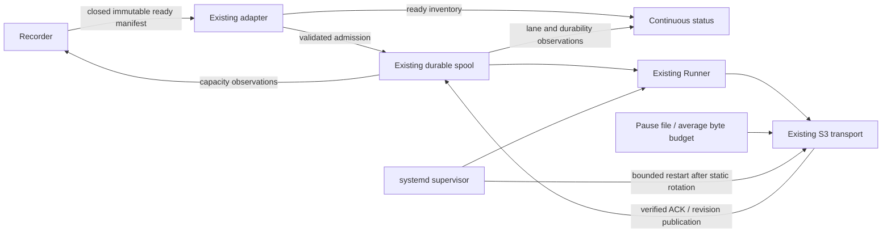

# Robotics SDK issue v2 — remaining integration fixes

Date: 2026-10-13
Version: 1.1
Release target: v0.2.2
Status: implemented, tested and published on public main.

## Verification status — 2026-10-13

Implementation includes producer capacity/discovery observations, read-only status
and Prometheus metrics, average video scheduling, a dock pause gate and reference
systemd/fleet operations.

- Focused tests and complete `bash test.sh test`: passed in the public checkout
  and requested monorepo target, including reference SDK wire checks in the latter.
- `bash test.sh package`, wheel/sdist installed-import/export checks and
  `python3 -m twine check dist/*`: passed for package version 0.2.2.
- Ubuntu 22.04 / Python 3.10 / stock pip 22.0.2: ordinary isolated
  `python3 -m pip install .` and both installed CLI help entry points passed.
- Real MinIO exact-byte/idempotency/revision round trip: passed in a disposable
  container. Systemd unit verification passed on Ubuntu 22.04.
- `docs.py generate` / `docs.py check`, shell syntax, independent code review
  and whitespace checks: passed. Review findings on old bag replay, finite pacing
  and consistent CLI snapshots were fixed and regression-tested.
- Publication scan of the staged public tree: zero verified or unverified secrets.
- Requested target synchronized with the tested public implementation; the local
  environment's default video limit is also 1 GiB. Sibling SDK installation uses
  its own isolated build backend to avoid incompatible setuptools requirements.
- Public implementation commit:
  [39ee73e](https://github.com/v-modal/vmodal_sdk_robotics/commit/39ee73ea0195ed081a88ef7af93356c4a8db0f1e),
  pushed to `main` and `fix/issue-v2-operations`.
- [Public CI run 38396545013](https://github.com/v-modal/vmodal_sdk_robotics/actions/runs/38396545013)
  passed secret detection, native ROS 2 Humble/Python 3.10 and Jazzy/Python 3.12
  (including full suites and real recorder handoff), plus actual MinIO integration.
  No eight-hour hardware shift or deployed V-Modal backend is claimed.

## User Input Specs

Review unresolved items in `issue_v2.md` using a sub-agent, write this fixes plan,
implement carefully in `uinterface/sdk_ros_robot/lerobot`, run tests, then commit
and push the public robotics repository. Preserve native producer bytes, durable
admission, exact identity/checksum contracts, and the independent robot control loop.

## Scope

The public `lerobot/` tree is the delivery source; mirror the plan into the requested
monorepo path. Audit baseline: public `v0.2.1`, including its existing S3/MinIO and
closed-ROS-bag integration. The original report assessed `v0.2.0`, so its findings
must not be treated as defects that all still exist.

The public branch advanced during this audit: automated export republished older
version metadata alongside newer spool-lock, contract and temporal/dataset fixes.
Reconcile the v0.2.1 candidate onto the latest public branch with rebase, preserving
those valid newer changes, then synchronize the requested local target so later
export cannot undo these fixes. Do not execute `git merge`.

Primary folders: `src/vmodal_robot/`, `examples/`, `docs/`, and `tests/`.
Retain the existing spool, adapters, Runner, optional S3 transport, Fire CLI, and
offline assertion test pattern. Add no environment, dependency service, or generic
plugin framework. Configuration should use existing arguments/configuration where
possible; credential delivery remains in the existing AWS provider chain.

## Findings checked against the current checkout

Paths below are relative to public `lerobot/`. “Resolved” means existing source and
regression coverage address the reported code defect; it does not establish live
deployment qualification or a completed hardware endurance test.

| Reported issue | Baseline status and evidence | Remaining work |
| --- | --- | --- |
| Discovery stops after 100 manifests | Resolved. `adapters/lerobot.py:LeRobotAdapter.discover` filters seen/pending handoffs before its batch limit and rotates with `_cursor`; `tests/test_lerobot.py:test5` discovers 250 retained manifests over 100/100/50 batches. | Expose scan population and eligible backlog to monitoring. |
| Quiet data gap despite zero rejection counters | Partly resolved. Fair discovery removes the loss mechanism; `Spool.status` exposes rejected/deferred admission, but cannot report producer-ready files never attempted. | Add explicit ready-manifest inventory observations with timestamp and defined semantics. |
| 100 MiB video ceiling | Resolved for local admission and worked S3 path. `SpoolConfig.max_video_bytes` and `S3Transport.capabilities` are 1 GiB, and CLI controls are exposed. The upstream V-Modal SDK's separate cap still applies to implementations using that SDK. | Document segmentation and effective transport limit; preserve capability validation. |
| Quota refusal loses unchanged handoff | Resolved. Runner sends `admission_feedback(..., 'deferred')`; adapter releases pending handoff for fair rediscovery. `tests/test_runner.py:test5` verifies capacity recovery. | Add documented recorder-facing capacity guidance before refusal. |
| Recorder receives no backpressure | Unresolved. `Spool.status` has raw retained usage/headroom but no producer decision contract or signal. | P0 capacity snapshot and polling contract. |
| Upload backlog competes with control traffic | Unresolved. Runner has independent video/aux lanes and retries, but no bandwidth setting or dock policy. | P1 S3 average upload scheduling, docking pause-file gate and OS shaping recipe for an actual wire ceiling. |
| SIGTERM exceeds the requested drain budget | Resolved for cooperative async operations. Runner shares one absolute deadline through recovery, network operations and close; `tests/test_runner.py:test8` and CLI signal tests verify cancellation/preservation. A stuck kernel call still requires the supervisor hard stop. | P2 reference service stop budget and power-loss recovery guide. |
| No spool reclamation | Resolved. Admission and delivery call `Spool.cleanup`; it requires artifact ACK and every referencing revision ACK. Zero retention means immediate eligible reclamation, not disabled cleanup. | Preserve its tests and explain sizing/headroom. |
| Stock transport cannot deliver generic artifacts | Integration qualification remains unavailable for `VmodalTransport.from_env`; failing capability validation before creating a spool is intentional. | Use existing S3 service example; do not fabricate stock cloud qualification. |
| No ordinary object-storage reference | Resolved. `transports/s3.py`, `examples/s3_upload.py`, `docs/s3_transport.md`, and `tests/test_s3.py` provide immutable conditional PUT, verified GET/checksum and revision publication/recovery. | Extend the example with the remaining operating controls. |
| No ROS 2 ready-manifest bridge | Resolved for native closed ROS bags. `ros2_manifest.py`, `examples/record_bag.sh`, `docs/ros2_manifest.md`, and live ROS tests cover durable closure journal and asynchronous manifest publication. | This remains a closed-bag bridge, not a LeRobot episode recorder; document that boundary accurately. |
| Atomic handoff contract undocumented | Resolved. README and ROS guide require closed immutable source files, fsync and atomic ready publication. | Preserve those rules in producer capacity/identity instructions. |
| Robot and mission attribution missing | Partly resolved. Mandatory `source_id`, `dataset_key`, `source_revision` and original `source_refs` already survive spool and remote descriptors. No prescribed fleet convention links robot/mission to those fields. | P3 settle and test a backward-compatible identity convention. |
| No reference systemd unit | Unresolved. Python integration already supports signals, but service mount/user/restart wiring is absent. | P2 ship a qualified S3 service example. |
| No incident recovery procedure | Partly resolved. `docs/transport_contract.md` describes backup, uncertain reconciliation, selective requeue and database loss. | P2 add operational power-loss triage and concrete service commands. |
| Credential delivery/rotation unspecified | Partly resolved. S3 guide selects aiobotocore's standard credential chain but gives no rotation/restart procedure. | P4 document refreshable providers and static-secret replacement followed by bounded restart. |
| On-demand status lacks continuous fleet path | Unresolved. `RobotCli.status` emits one snapshot and labels stock V-Modal qualification, irrespective of an S3 service's configuration. | P5 Prometheus HTTP exporter using read-only spool queries and explicit ready inventory. |
| Ubuntu 22.04 pip 22.0.2 install fails | Resolved. Static metadata is in `setup.cfg`; build uses setuptools `<77`; public CI explicitly exercises pip 22.0.2 with ordinary `pip install .`. | Preserve package/CI checks. |
| Scripts use `python` instead of `python3` | Resolved. `cli.sh`, `install.sh`, `test.sh` use `python3`. | Preserve shell checks. |
| Wheel exports generic package `src` | Resolved. `setup.cfg` includes only `vmodal_robot` and subpackages; `tests/test_artifacts.py` checks wheel members contain no `src/`. | Preserve install/package checks. |
| Unprivileged default spool path cannot be created | Resolved distinction. Actual CLI default is `./vmodal_robot_spool`; `/var/lib/vmodal-robot` is a deployment example with documented provisioning. | P2 use `StateDirectory` and persistent mount ordering. |

## Critical invariant

The producer owns mutable recordings and ready-manifest commit records. The spool
owns only verified immutable copies. Capacity guidance and metrics cannot delete
producer bytes, ACK work, or replace admission validation. Remote verified receipts
and published revisions remain the sole cleanup authority.

An upload policy may defer network work but must keep accepted bytes durable,
respect the existing drain deadline, and preserve independent lanes. A schedule
based on artifact sizes limits average dispatch rate; it must not be described as
an instantaneous network cap. A strict shared-interface/wire ceiling belongs to
stream shaping or documented Linux traffic control, including verification GETs.

## Data Contract

- **Producer capacity:** `Spool.status().admission_pressure` includes
  `pause_recording`, `pause_video_recording`, `recommended_action`, `reasons`,
  `byte_headroom`, `video_headroom`, `record_headroom`, `aux_reserve_bytes`,
  `latest_deferral`, `deferral_scope` and `next_manifest_fits:null`. Actions are
  `continue`, `pause_recording`, `pause_video_recording`, or `segment_video`.
  Unresolved deferral remains visible until successful readmission. State is
  advisory and cannot forecast an unknown next manifest's fit. A producer still
  handles authoritative admission deferral. Video pressure preserves auxiliary capture.
- **Ready discovery:** `LeRobotAdapter.discovery_status()` returns `ready_dir`,
  `started_at`, `observed_at`, `scope:adapter_instance_current_manifests`,
  `manifests_present`, `unseen`, `pending`, `deferred`, `rejected`, and `admitted`.
  Counts are exclusive states for the current path/size/mtime population. Runner
  persists snapshots through `Spool.record_discovery` in `spool_meta.discovery`.
  Do not equate these process-local observations with durable lifetime admissions.
  Restart resets observations; spool deduplication handles rediscovery.
- **Upload control:** defaults preserve current unlimited uploads. All rates,
  thresholds and intervals are finite and validated.
  `S3Transport(..., video_bytes_per_second=0, pause_file='')` schedules video
  attempts by precharging their byte budget; auxiliary artifacts remain unpaced.
  This limits average video scheduling with explicit burst/verification GET limits.
  An existing pause file gates new network requests while driving; removing it when
  docked permits progress. It does not stop in-flight requests. Shutdown does not
  bypass it silently; pauses remain cancellable.
- **Identity:** robot identity maps to `source_id`; mission/session identity is
  included in `dataset_key`; a unique closed capture boundary maps to
  `source_revision`. Destination may be shared. Document stability and examples;
  reuse existing fields rather than migrating database IDs. Optional detailed
  attribution can be included in the immutable metadata snapshot/source refs.
  `os_bag_manifest(..., fleet_refs=False)` and the closed-bag node keep existing
  default bag bytes/manifest identity stable. Explicit `fleet_refs=True` adds
  `robot_id=source_id` and `mission_id=dataset_key` only for new mission/dataset
  scopes; enabling it for previously accepted artifacts would conflict with
  immutable descriptors and must not be used to rewrite an existing dataset.
- **Monitoring:** `vmodal-robot-metrics serve --spool_dir=... --host=127.0.0.1
  --port=9108` provides an HTTP `/metrics` endpoint exporting Prometheus observations from
  SQLite in read-only mode without creating, migrating, recovering or cleaning a
  spool. `Spool(cfg, readonly=True)` observes under the existing daemon lock while
  persisted `spool_meta.configuration` supplies actual quotas and Runner retention.
  Preserve lane oldest age/pending bytes, spool bytes, retries and
  deferred/blocked counts, capacity guidance and ready inventory. Missing or
  incompatible spools yield HTTP 503 and `up=0` while the service keeps running;
  successful consistent read-transaction snapshots yield HTTP 200. Do not label a working
  S3 service as the unavailable stock constructor. A monitor never claims live
  remote qualification from local state.
- **Credentials:** refreshable provider credentials use SDK refresh behavior;
  replacing static profile/environment credentials requires a controlled service
  restart. The immutable spool and remote reconciliation resolve interrupted work.

## Component Diagram Flows



### Coupling and dependencies between components

Core remains ROS/cloud independent. Adapter inventory is an optional hook; custom
adapters implementing only `discover(limit)` continue working. Producer guidance
reads spool configuration/state. Monitoring reads the spool contract without a
competing queue implementation or write connection. Deployment uses the worked S3 Runner path;
the unavailable stock constructor is not used in the reference service.

## Folder Tree files Structure

```text
src/vmodal_robot/
  spool.py                 # capacity/status snapshots; durable rules preserved
  transports/s3.py         # average upload budget and optional docking pause
  adapters/lerobot.py      # fair discovery and inventory observations
  monitoring.py            # Prometheus endpoint over read-only spool observations
examples/
  s3_upload.py             # S3 operating controls and service entry point
  systemd/                 # uploader/exporter units and example configuration
docs/
  fleet_operations.md      # producer, fleet identity, monitoring, recovery, rotation
  s3_transport.md          # link operating controls and bandwidth limitations
  todo/issue_v2_fixes.md    # this audited plan
tests/
  test_spool.py            # quota guidance and reserve edge conditions
  test_lerobot.py          # ready inventory above one discovery batch
  test_runner.py           # signal cancellation and lane independence regressions
  test_monitoring.py       # Prometheus observations and absent/read-only spool
  test_s3.py               # immutable delivery/recovery regressions
  test_artifacts.py        # installed package and public artifact checks
```

## List of potential failures issues

| Component | Failure and mitigation |
| --- | --- |
| Producer | Snapshot becomes stale: advisory only; keep authoritative atomic quota checks. |
| Capacity | Video reserve incorrectly stops telemetry: expose separate reasons/budgets. |
| Discovery | Thousands of retained manifests or invalid files: inventory remains visible and fair polling continues. |
| Monitor | Restart turns seen into durable admitted count: define process-local semantics and timestamps. |
| Upload policy | Long throttle sleep overruns shutdown: use cooperative waits covered by existing deadline. |
| Upload policy | Video pacing blocks telemetry: pace only video attempts; preserve independent auxiliary lane. |
| Transport | Whole-file pacing still bursts on the wire: provide OS shaping recipe for strict control; egress TBF alone does not shape inbound verification GETs, which need ingress/IFB policy. |
| Service | Mounted partition absent: require mounts before creating spool directories. |
| Service | systemd kills before drain finishes: set `TimeoutStopSec` above configured drain plus explicit hard-stop allowance. |
| Rotation | Static client retains old credentials: replace provisioned credential source atomically, then bounded restart. |
| Recovery | Operator deletes SENDING objects to free space: document pending/uncertain retention and ID-scoped triage. |
| Identity | Robot/mission name changes during one immutable dataset: document stable values; never rewrite accepted manifests. |

## List of files to be changed

- `src/vmodal_robot/spool.py`: capacity guidance, persisted discovery/configuration and read-only observation without altering admission/cleanup.
- `src/vmodal_robot/adapters/lerobot.py`: expose ready inventory with process-local semantics.
- `src/vmodal_robot/transports/s3.py`: optional average scheduling and pause file, preserving deadlines.
- `src/vmodal_robot/runner.py`: persist discovery snapshots and effective retention configuration.
- `src/vmodal_robot/utils.py`, `src/vmodal_robot/ros2_manifest.py`: opt-in fleet
  references with unchanged historical default bag handoffs.
- `src/vmodal_robot/monitoring.py`: read-only spool/ready observations and Prometheus HTTP endpoint.
- `examples/s3_upload.py`: wire operating controls into a working transport path.
- `docs/fleet_operations.md`, `examples/systemd/vmodal-robot.service`,
  `examples/systemd/vmodal-robot-metrics.service`, `examples/systemd/vmodal-robot.env`:
  deployment, identities, recovery, credential rotation and monitoring configuration.
- `README.md`, `docs/s3_transport.md`: entry points, limits and operational guide links.
- `docs/ros2_manifest.md`: stable robot/mission convention and new-scope opt-in rule.
- Existing relevant tests and `test.sh`: targeted assertions and complete suite registration.

## Implementation Blocks and Steps

### P0 — Producer backpressure and discovery observability

Reuse `Spool.status`, `SpoolConfig` and adapter admission feedback. Add a capacity
snapshot with separate video/auxiliary constraints and reasoned producer guidance.
Expose ready inventory through an optional adapter interface and status sampling.
Document producer actions without adding blocking calls to a robot control loop.

Existing tests: `tests/test_spool.py`, `tests/test_lerobot.py`, `tests/test_runner.py`.
Test cases: quota full/recovered, record limit, protected aux reserve, low physical
space, more than 100 retained manifests, deferred/invalid handoffs, restart semantics.

### P1 — Bandwidth and dock policies

Add validated optional S3/example controls with unlimited defaults. Reuse the
existing independent async lane scheduler and deadline machinery. Pace uploads
with an optional video byte budget and support a pause file for docked-only
operation. Preserve unpaced auxiliary delivery. Label whole-artifact pacing as average scheduling; document
Linux traffic shaping for a strict network ceiling/interface selection. Verification
downloads also compete for the link and must be accounted for operationally.

Existing tests: `tests/test_runner.py`, `tests/test_s3.py`.
Test cases: default throughput unchanged, video rate behavior with auxiliary progress,
aux progress while video pauses, no invalid NaN/infinite/negative rates, SIGTERM
during a throttle wait, backlog preservation while dock gate is closed.

### P2 — Reference service and power-loss recovery

Ship a systemd example invoking the existing S3 integration, with persistent mount
ordering, user-writable state, restart-on-failure and bounded stop policy. Choose
explicit 30-second runner drain and a larger supervisor hard-stop budget (for
example 45 seconds); document that arbitrary stuck kernel I/O has no Python upper
bound. Provide triage commands checking SQLite state, payload existence, deferred
handoffs and resumed verified receipts, linked to existing migration/recovery guide.

Verification: inspect unit directives; run `systemd-analyze verify` where available.
Existing signal/recovery tests remain required. Do not claim local macOS execution
is a Linux systemd service qualification.

### P3 — Robot and mission identity

Document fleet convention on mandatory existing manifest fields. Include examples
for two robots writing one destination and one robot across multiple missions.
Verify remote descriptors and revisions preserve those values and original refs;
leave stable IDs and contract version unchanged.

Default bag manifest generation must preserve pre-upgrade artifact descriptors and
identity on repeat publication. Offer explicit `fleet_refs=True` only for a new
`dataset_key`/mission scope, and test both default replay and opted-in attribution.

Existing tests: `tests/test_lerobot.py`, `tests/test_spool.py`, `tests/test_s3.py`.
Test cases: shared destination does not merge robot datasets; changed mission key
creates distinct datasets; repeated identical capture remains deduplicated.

### P4 — Credential delivery and rotation

Extend the S3 deployment guide with existing credential provider choices. Define
refreshable-provider automatic refresh and static-profile/environment replacement
plus restart, without exposing real credentials or adding redundant environment
variables. Link selective requeue/reconciliation for fixed authorization blocks.

Verification: review examples for consistent provider/restart behavior and preserved
spool paths; keep S3 unavailable/unknown/auth-block distinction tests.

### P5 — Continuous fleet status

Provide `vmodal-robot-metrics serve` (also `python3 -m vmodal_robot.monitoring`), a
small Prometheus HTTP exporter with configurable bind address/port and
read-only SQLite access. Reuse spool schemas and inventory observations; do not
instantiate the state-owning spool in another service. Expose explicit health for
absent/incompatible spool and define retained ready inventory versus admission
counts. On-demand stock status still describes its stock constructor.

New tests: `tests/test_monitoring.py`, using `metrics_server` and `spool_snapshot`.
Test cases: actual `/metrics` HTTP response,
backlog/lane/capacity fields, ready inventory semantics, absent spool, no directory
creation or schema mutation, read-only concurrent sampling and clean service stop.

## Test Critical List

- `tests/test_lerobot.py`: fair discovery, retained-manifest inventory and atomic contract.
- `tests/test_spool.py`: authoritative quota, aux reserve, capacity guidance, ACK cleanup.
- `tests/test_runner.py`: independent scheduling, outages, uncertain recovery and drain.
- `tests/test_cli.py`: shutdown and unavailable-stock fail-fast regressions.
- `tests/test_monitoring.py`: HTTP Prometheus output without spool mutation.
- `tests/test_s3.py`: native byte equality, descriptor attribution and idempotent recovery.
- `tests/test_ros2_manifest.py`: closed-bag handoff remains durable and deduplicated.
- `tests/test_artifacts.py`: no generic `src` wheel package; public installation remains valid.

## Test for Data Contract List

Tests must demonstrate no change to accepted artifact/revision identity, source
references, native bytes, ACK authority or cleanup ownership. New observability
fields are additive. A producer obeying guidance still cannot bypass quota checks.
Use existing synthetic fixtures and straightforward numbered assertion functions;
do not mask failures with exception fallbacks or introduce pytest.

Run focused modified-module tests, then `bash test.sh test` and `bash test.sh package`
from public `lerobot/`. Run additional real MinIO/ROS/systemd checks when those
environments are available; otherwise explicitly record their unrun status.

## Implementation Order

1. P0 first: establish additive producer/discovery observations and regression tests.
2. P1 next: upload policy with cancellation and rate-semantics tests.
3. P3/P5: preserve fleet attribution and expose continuous monitored observations.
4. P2/P4: wire the service, stop budget, recovery and credential rotation instructions.
5. Review final code/doc contract, run core/package tests, preserve existing public
   secret-detection release gates, commit only intended target changes and push.

The original review remains historical evidence. Completing these fixes does not
qualify a V-Modal generic backend, cloud search readiness, arbitrary native shard
sizes, hard real-time control or an eight-hour robot shift; those require deployed
transport/producer/hardware evidence.
